# Biblioteca UNCP — Práctica de la Semana 10

Aplicación académica para registrar y gestionar libros y equipos electrónicos de una biblioteca. La entrega incluye **una aplicación de consola en Python** y **una interfaz estática independiente en `index.html`**. No se utilizan bases de datos ni frameworks; ambos catálogos permanecen solo en memoria y **se pierden al cerrar el programa o recargar la página**. La página no se comunica con Python.

## Requisitos y ejecución

- Linux Mint u otro sistema con **Python 3.11 o superior** (verificado con Python 3.12.3).
- No hay paquetes Python externos; `requirements.txt` es informativo. Para la página basta un navegador moderno con JavaScript habilitado; se comprobó su renderizado con Firefox.

Desde una terminal, ejecute exactamente:

```bash
cd ~/universidad/Sem10
python3 main.py
```

Para ejecutar las pruebas automáticas desde la misma carpeta:

```bash
python3 -m unittest discover -s tests -v
```

Para abrir la interfaz alternativa, abra `index.html` en Firefox (por ejemplo, `firefox index.html` desde la carpeta del proyecto). Funciona con el protocolo `file://`, sin servidor, instalación ni conexión a Internet. El JavaScript está integrado en el HTML y no tiene dependencias de Python. El programa de consola sigue siendo la implementación de POO solicitada; el navegador ofrece una interfaz complementaria con reglas equivalentes para el usuario, no comparte objetos ni almacenamiento con ella.

## Estructura

```text
Sem10/
├── main.py                 # Menú CLI y demostración aislada
├── biblioteca.py           # Catálogo en memoria (composición)
├── index.html              # Interfaz web local (CSS y JS integrados)
├── models/
│   ├── __init__.py
│   ├── producto.py
│   ├── libro.py
│   └── electronico.py
├── utils/
│   ├── __init__.py
│   ├── exceptions.py
│   └── validators.py
├── tests/
│   ├── __init__.py
│   └── test_biblioteca.py
├── Capturas/               # Capturas de ejecuciones y navegador reales
├── README.md
└── requirements.txt
```

## Funcionalidades y ejemplo

El menú permite: **1** registrar libros, **2** registrar equipos electrónicos, **3** listar el catálogo, **4** buscar por código, **5** actualizar precio o cantidad mediante propiedades, **6** mostrar precios finales, **7** ejecutar una demostración reproducible y **8** salir. Tras cada operación se vuelve al menú; un código duplicado no sobrescribe el registro existente. Los códigos se normalizan a mayúsculas y se eliminan espacios exteriores.

Ejemplo: seleccione `1`, complete `L-1`, `Python básico`, `100`, `2`, `Autora UNCP`, `978-0001`; seleccione `2` y complete `E-1`, `Lector digital`, `200`, `1`, `Marca UNCP`, `12`. `3` muestra ambos objetos, `4` permite encontrar `l-1` y `6` muestra `S/ 90.00` y `S/ 230.00`. Con `5` puede modificar un precio o una cantidad; `7` crea su **propio catálogo temporal**, muestra un éxito, un duplicado y una búsqueda inexistente sin alterar los registros de la sesión. Los precios son valores académicos de demostración, no tarifas oficiales.

La página permite registrar ambos tipos, mostrar todos, buscar, modificar precio o cantidad y ejecutar una demostración aislada. Sus avisos se muestran en la misma página; no hay persistencia ni sincronización con la CLI.

## Diagrama de clases (implementación Python)

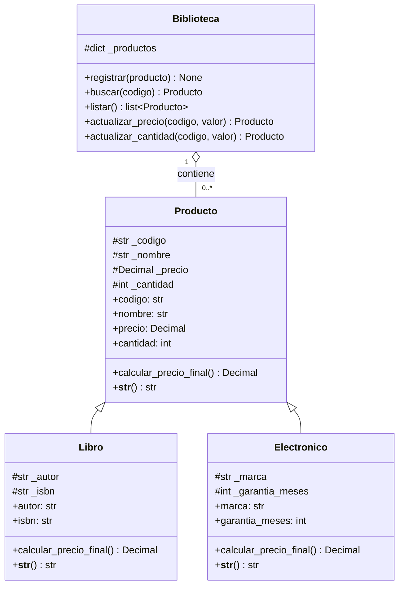

`Libro` y `Electronico` **son productos**: comparten código, nombre, precio y cantidad, pero necesitan campos y cálculos propios. La herencia reutiliza las propiedades y presenta ambos objetos con el mismo contrato. `Biblioteca`, en cambio, **contiene productos**, no es un producto: heredar de `Producto` la obligaría absurdamente a tener precio y cantidad. El diccionario `_productos` materializa esa relación de composición/agrupación en memoria.

## Encapsulamiento, validación y polimorfismo

Los datos de los modelos usan atributos protegidos `_campo`; se accede a ellos a través de `@property` y setters. Tanto en `__init__` como en actualizaciones, los setters rechazan textos obligatorios vacíos, precios negativos, no numéricos o no finitos y cantidades que no sean enteros no negativos. Autor, ISBN y marca son obligatorios; garantía debe ser un entero no negativo. El código no puede cambiar una vez asignado para no desincronizar el índice del catálogo. El precio se convierte a `Decimal` para el cálculo en Python; las entradas numéricas enteras erróneas se convierten en `ValidationError` desde la CLI. Un fallo en el setter no reemplaza el valor anterior.

`Biblioteca.listar()` devuelve una **colección mixta** de `Libro` y `Electronico`. `mostrar_precios()` llama a `producto.calcular_precio_final()` para cada elemento **sin preguntar por el tipo**; el despacho dinámico usa el método sobrescrito:

| Clase | Regla académica supuesta | Precio base S/ 100 |
| --- | --- | ---: |
| `Libro` | Descuento de 10 %: `precio × 0.90` | S/ 90.00 |
| `Electronico` | Recargo de 15 %: `precio × 1.15` | S/ 115.00 |

`__str__` combina la representación uniforme de `Producto` con los datos particulares mediante `super().__str__()`.

### MRO y `super()`

El orden real de resolución de métodos, mostrado por la opción `7` y comprobado en las pruebas, es:

```text
Libro.__mro__       = (Libro, Producto, object)
Electronico.__mro__ = (Electronico, Producto, object)
```

En ambas subclases `super().__init__(...)` continúa al siguiente eslabón del MRO (`Producto.__init__`) para inicializar los campos compartidos. `super().__str__()` reutiliza la salida de `Producto`; el cálculo final no usa `super()` porque reemplaza deliberadamente la regla base. No se necesita herencia múltiple ni `DescuentoMixin` para estas dos reglas sencillas.

`__del__` es un finalizador que Python podría invocar al destruir un objeto. Su momento de ejecución **no es determinista** (depende de referencias, recolector e intérprete), por lo que no se implementa aquí ni se emplea para guardar datos o cerrar recursos críticos.

## Errores controlados

- `ValidationError` (`utils/exceptions.py`): campo inválido o vacío, número inválido, código duplicado u opción incorrecta.
- `NotFoundError` (`utils/exceptions.py`): código inexistente en búsquedas o actualizaciones.
- `leer_entero()` intercepta `ValueError` de `int()` y lo transforma en `ValidationError`. `precio_no_negativo()` intercepta errores de conversión de `Decimal` y rechaza `NaN` e infinitos. La CLI muestra mensajes comprensibles y permite continuar.

El flujo real `procesar_operacion()` usa los cuatro bloques: `try` ejecuta la opción seleccionada; `except` muestra el tipo y mensaje de un error esperado sin traceback; `else` confirma una operación exitosa; `finally` señala el final del intento **haya éxito o error**. En el bucle principal, `EOFError` y `KeyboardInterrupt` producen un cierre cordial. La demostración del menú, por separado, captura y muestra exactamente un `ValidationError` y un `NotFoundError`.

## Evidencia visual

Estas capturas proceden de terminales que ejecutaron comandos reales y de Firefox; algunas salidas de terminal se **filtraron con `grep` para mantener legibles en una sola pantalla los resultados**, sin sustituirlas por texto inventado.

| Hito | Captura |
| --- | --- |
| Estructura inicial | 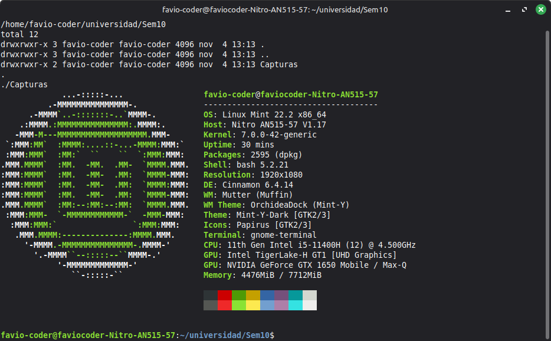 |
| Clases y herencia | 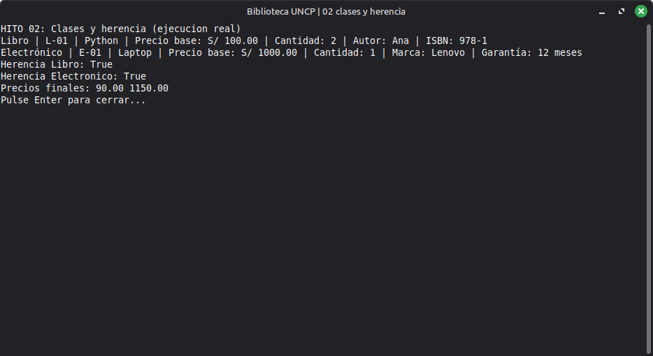 |
| Propiedades y validaciones | 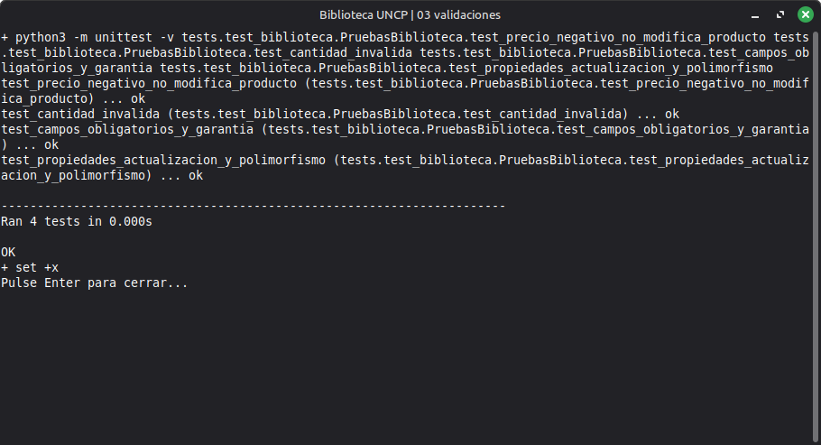 |
| Menú y salida | 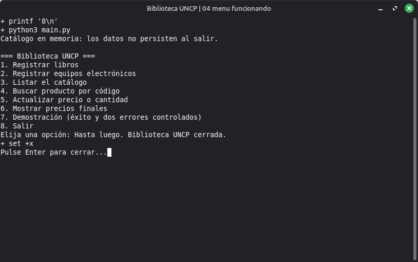 |
| Registro exitoso, listado, búsqueda y precios | 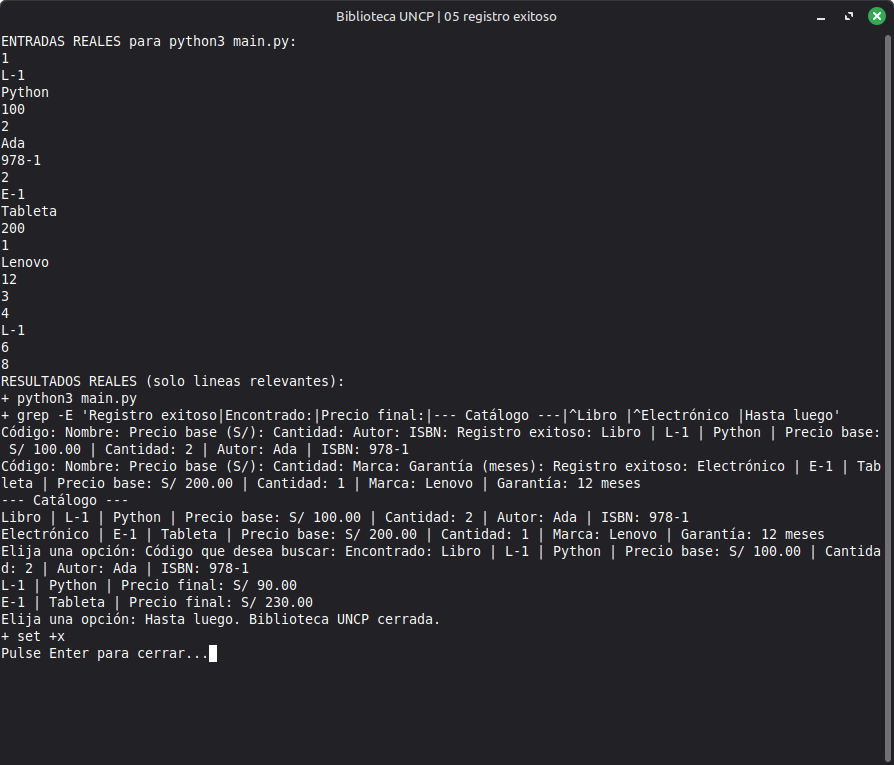 |
| Duplicado, precio negativo y número incorrecto | 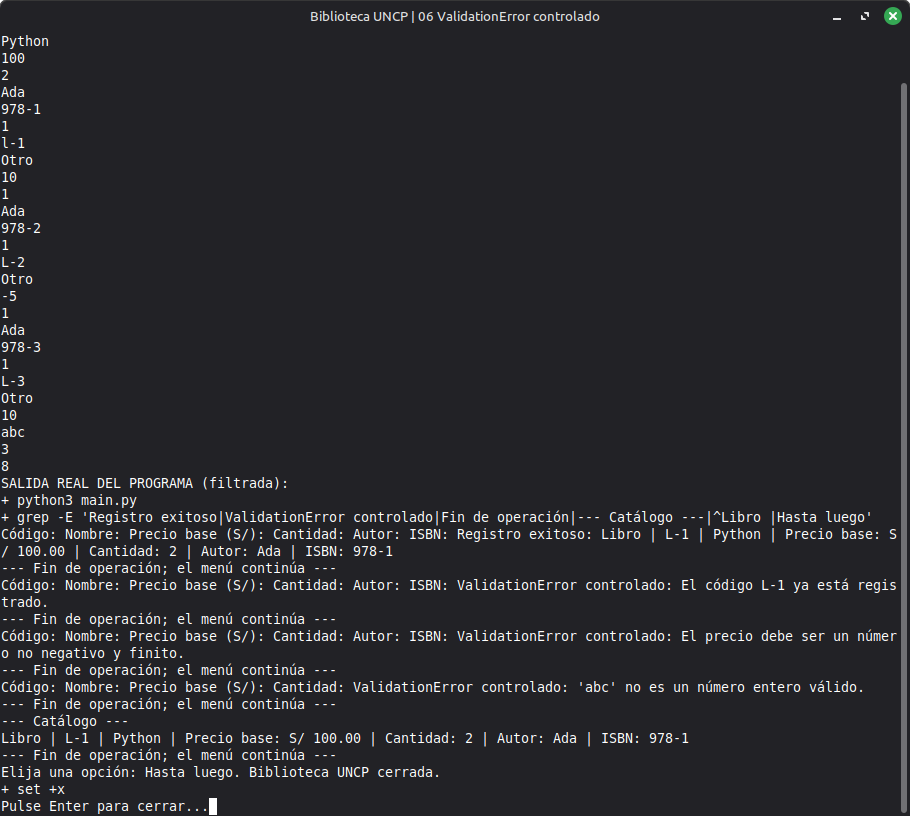 |
| Búsqueda inexistente y continuidad | 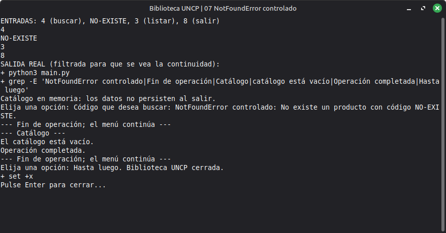 |
| Polimorfismo, demostración y MRO | 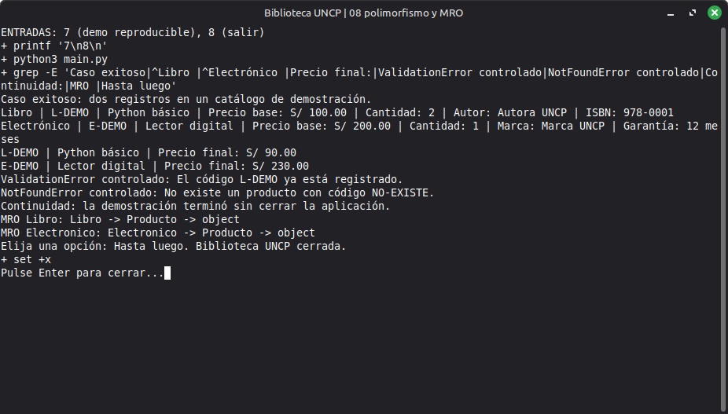 |
| Pruebas finales | 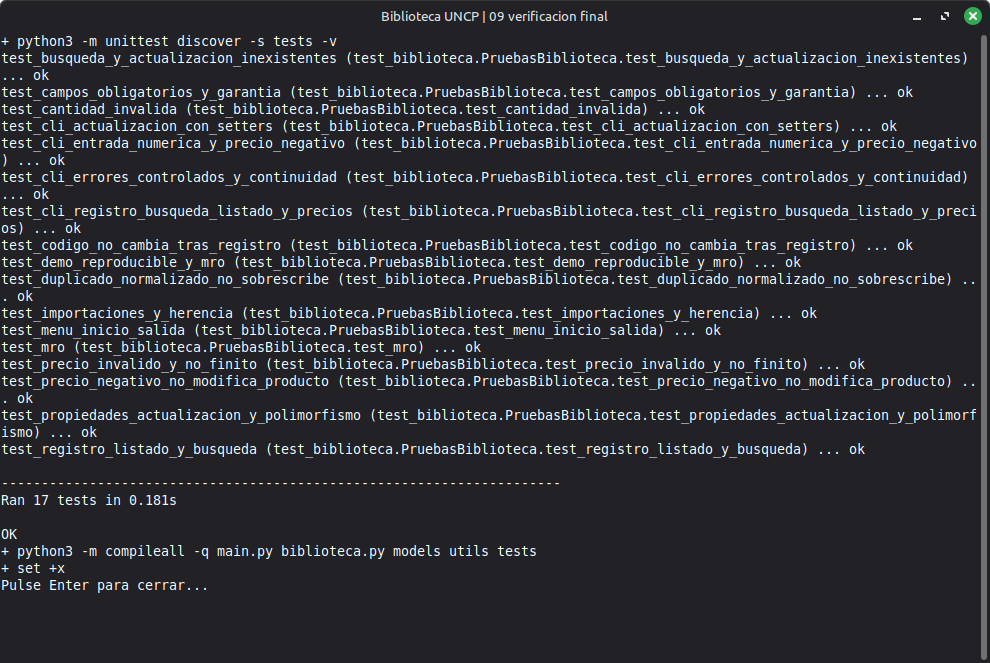 |
| Página HTML en Firefox | 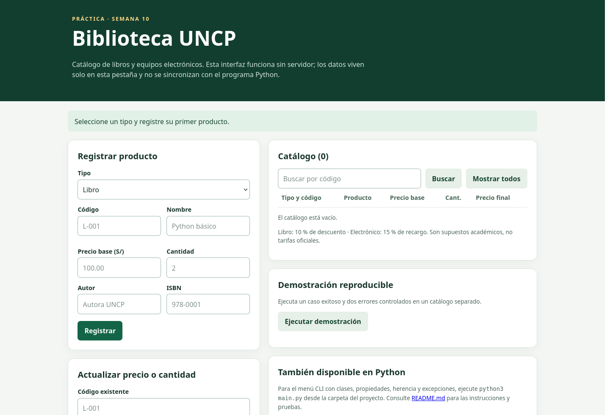 |

## Verificación y limitaciones

Se ejecutaron 17 pruebas `unittest` que abarcan importaciones, herencia, alta de ambos tipos, listado, búsqueda, duplicados, validaciones, inmutabilidad del código, actualizaciones, polimorfismo, MRO, inicio/salida y continuidad tras errores desde `python3 main.py`. Se comprobó la sintaxis JavaScript con `node --check`, se probaron sus eventos de registro, búsqueda, duplicado, actualización y demostración en un entorno de prueba de DOM, y se renderizó `index.html` con Firefox. Node se utilizó **solo para verificar** el JavaScript: no es necesario para usar ninguna de las dos interfaces.

Limitaciones: los datos no persisten; tampoco se comparten entre CLI y navegador; el ISBN solo se valida como texto obligatorio, no se comprueban dígitos de control; los precios de pantalla se muestran con dos decimales pero no se imponen dos decimales a las entradas; la versión de navegador utiliza `Number` de JavaScript, mientras Python usa `Decimal`. No hay servidor ni permisos de usuario; las reglas de precio son supuestos didácticos.
